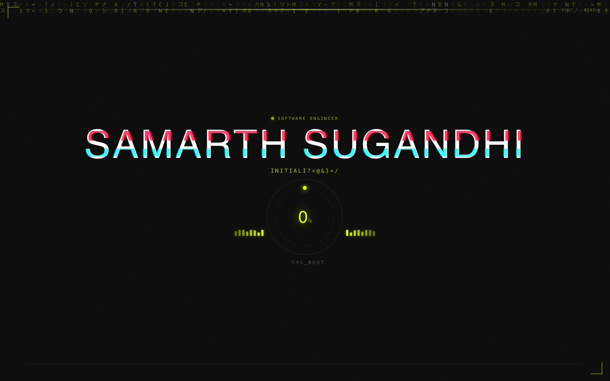
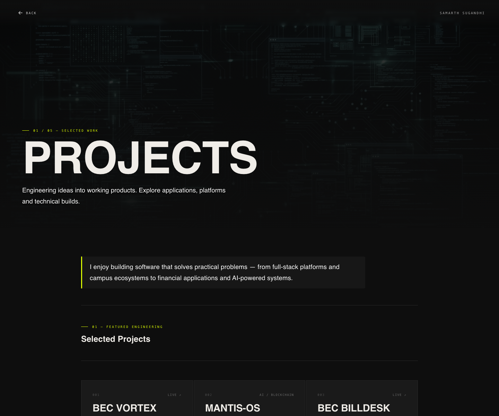
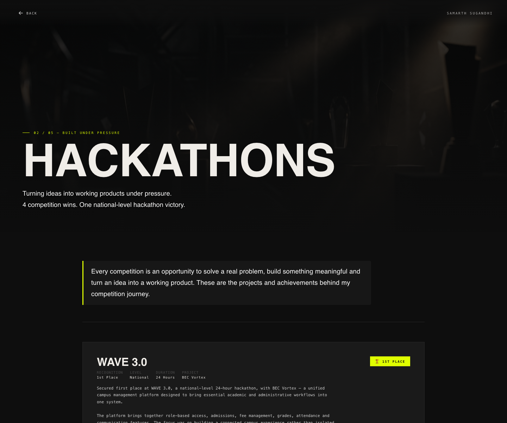
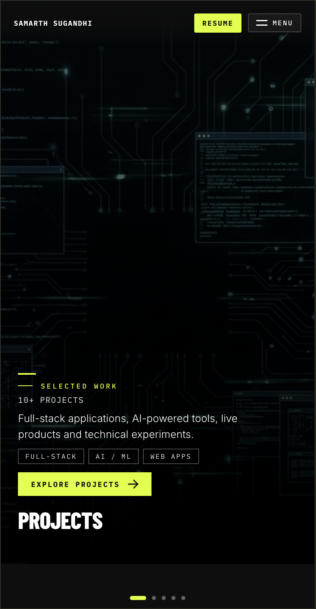

# ⚡ SAMARTH SUGANDHI — PORTFOLIO

<div align="center">

[](https://samarthsugandhi.github.io/sam_portfolio/)
[](./Samarth_Sugandhi_Resume.pdf)
[](https://www.linkedin.com/in/samarth-sugandhi-0082a32bb/)
[](https://github.com/samarthsugandhi)

<br/>

```
  ██████╗  ██████╗ ██████╗ ████████╗███████╗ ██████╗ ██╗     ██╗ ██████╗ 
  ██╔══██╗██╔═══██╗██╔══██╗╚══██╔══╝██╔════╝██╔═══██╗██║     ██║██╔═══██╗
  ██████╔╝██║   ██║██████╔╝   ██║   █████╗  ██║   ██║██║     ██║██║   ██║
  ██╔═══╝ ██║   ██║██╔══██╗   ██║   ██╔══╝  ██║   ██║██║     ██║██║   ██║
  ██║     ╚██████╔╝██║  ██║   ██║   ██║     ╚██████╔╝███████╗██║╚██████╔╝
  ╚═╝      ╚═════╝ ╚═╝  ╚═╝   ╚═╝   ╚═╝      ╚═════╝ ╚══════╝╚═╝ ╚═════╝ 
```

**Software Engineer • Full-Stack Developer • 4x Hackathon Winner**  
*Turning ideas into high-performance, real-world systems under pressure.*

<br/>

</div>

---

## 🌟 Overview

Welcome to the official repository for **Samarth Sugandhi's** engineering portfolio. 

Engineered with a raw **Dark Carbon (`#0E0E0E`) & Acid Lime (`#DFFF00`)** cyberpunk aesthetic, this portfolio is built to reflect modern high-performance systems engineering: ultra-crisp typography, zero external UI framework overhead, custom Canvas graphics, and fluid mechanical transitions.

### 🔑 Key Engineering Highlights
- 🧠 **Neural Compile v2 Preloader**: 60fps Canvas matrix rain, audio EQ frequency visualizer, 3D mouse parallax tilt, dual-spark compile ring, live HUD boot timer, and horizontal slice-shatter exit.
- 🗜️ **5-Panel Compression Engine**: Cinematic horizontal accordion architecture that smoothly distributes viewport weight between Projects, Hackathons, Journey, Engineering, and GitHub.
- 📱 **Glassmorphic Mobile Experience**: Viewport-locked 100dvh mobile architecture, staggered navigation animations, and quick-access sheets for About, Contact, and Resume.
- 🏆 **Track Record of Victory**: Documented 4 national and collegiate competition wins, showcasing rapid product development under strict time constraints.

---

## 📸 Visual Showcase

<div align="center">

### ⚡ Neural Compile v2 (Preloader Sequence)
*Hardware-accelerated Matrix rain canvas, 3D mouse tilt, animated EQ bars, HUD diagnostics, and text scramble engine.*



<br/>

---

### 💻 Featured Projects View
*Showcasing production-grade campus operating systems, trustless AI settlement layers, and financial platforms.*



<br/>

---

### 🏆 Competition Wins & Hackathons
*Highlighting 1st place victories at national hackathons, technical paper presentation awards, and collegiate championships.*



<br/>

---

### 📱 Adaptive Mobile Architecture
*100dvh viewport fitting, custom animated slide-out menu drawer, and zero-compromise typography.*



</div>

---

## 🛠️ Tech Stack & Capabilities

```ascii
[ FRONTEND ] ── Next.js 14 • React • TypeScript • Vanilla JavaScript (ES6+) • Tailwind CSS • HTML5/CSS3
[ BACKEND  ] ── Node.js • Express.js • REST APIs • WebSocket / Socket.IO • Microservices
[ DATABASE ] ── MongoDB • PostgreSQL • Mongoose • Cloud Firestore
[ SYSTEMS  ] ── Git • Linux / POSIX Shell • Distributed Systems • Canvas 2D API • Performance Tuning
```

---

## 🚀 Featured Projects

| Project | Focus | Tech Stack | Highlights |
| :--- | :--- | :--- | :--- |
| **[BEC Vortex](https://becvortex.onrender.com/)** | Unified Campus OS | `Next.js` `TypeScript` `MongoDB` `Socket.IO` `Tailwind` | End-to-end campus platform: role-based access, attendance, fees, real-time messaging, and AI assistants. |
| **[Mantis-OS](https://github.com/samarthsugandhi)** | Trustless AI Settlement | `Multi-Agent AI` `Smart Contracts` `SHA-256` | 15-node multi-agent architecture with automated technical arbitration and cryptographic validation footprints. |
| **[BEC BillDesk](https://github.com/samarthsugandhi)** | Institutional FinTech | `React` `Node.js` `Express` `MongoDB` | Streamlined campus fee configuration, transaction tracking, and automated digital ledger workflows. |

---

## 🏆 Hackathon Victories & Accolades

- 🥇 **WAVE 3.0 — National Hackathon** | *1st Place (National Winner)*
  - 24-hour national hackathon victory for conceiving, architecting, and deploying **BEC Vortex** under time pressure.
- 🥇 **INNOVATEX** | *Winner*
  - Championship victory on 4 hours Prototype building competition at Presidency University.
- 🥇 **Project Contest** | *1st Prize — Project Contest*
  - Awarded 1st place at Basaveshwar Engineering College, Bagalkote.
- 🥇 **INNOVATE 2026** | *1st Prize — Technical Paper Presentation*
  - Awarded 1st place at Basaveshwar Engineering College, Bagalkote (Nov 12, 2026).

---

## 📁 Repository Structure

```tree
sam_portfolio/
├── index.html                   # Main 5-panel compression portfolio + Neural Compile v2
├── projects.html                # Detailed project architecture & system catalog
├── hackathons.html              # Competition victories, timeline & trophy showcase
├── journey.html                 # Developer timeline, engineering milestones & background
├── engineering.html             # Systems engineering capabilities & architecture principles
├── github.html                  # Live open-source repository insights & stats
├── samarth-style.css            # Master styles: custom theme tokens, typography & HUD
├── samarth-script.js            # Engine logic: Matrix rain, visualizer, modals & APIs
├── detail-style.css             # Unified styling system for sub-pages
├── Samarth_Sugandhi_Resume.pdf  # Downloadable professional curriculum vitae
└── assets/
    └── screenshots/             # High-resolution README showcase previews
```

---

## ⚡ Local Setup

To run and explore the portfolio locally:

```bash
# Clone the repository
git clone https://github.com/samarthsugandhi/sam_portfolio.git

# Navigate into the project directory
cd sam_portfolio

# Open index.html directly in your default browser
open index.html

# OR serve using any lightweight static server
npx serve .
# or: python3 -m http.server 3000
```

---

## 📬 Connect & Collaborate

I'm always open to discussing full-stack systems engineering, distributed architectures, high-impact hackathon collaborations, and software engineering opportunities.

- **Portfolio**: [samarthsugandhi.github.io/sam_portfolio](https://samarthsugandhi.github.io/sam_portfolio/)
- **LinkedIn**: [linkedin.com/in/samarth-sugandhi-0082a32bb](https://www.linkedin.com/in/samarth-sugandhi-0082a32bb/)
- **GitHub**: [@samarthsugandhi](https://github.com/samarthsugandhi)

<br/>

<div align="center">
  <sub>Designed & Developed by <b>Samarth Sugandhi</b> • Built with precision & high standards.</sub>
</div>
